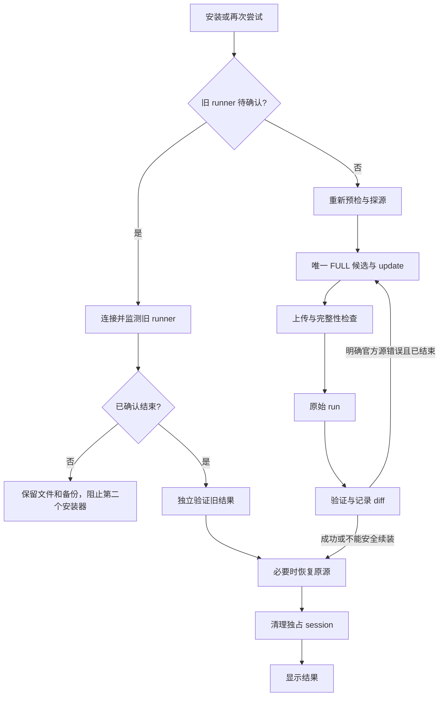

# V0.3.2 极简界面与安装编排验证报告

2026-10-12～13（Asia/Taipei）。现有项目：`C:\Development\iStoreOS-Plugin-Helper`。程序集 **0.3.2.0**，顶栏 **V0.3.2**。未新建项目，未进入 V0.4。

**Release x64：0 warning / 0 error；206 passed / 0 failed，原有 140 + 新增 66。** 窗口启动与布局检查通过，用户已确认“UI 回归通过，日志已保存”。本轮没有执行真实 PassWall `.run`，没有故意破坏真实软件源、卸载插件或控制代理。新增自动续装 / 恢复使用 Fake 和原安装服务组合测试；真实日志确认了新版本连接与环境记录，文件选择 / 折叠交互按用户回报记录。

## 1. 修改文件

相对 V0.3.1.1，**13 个已有文件**：

| 文件 | 内容 |
| --- | --- |
| `src/iStoreOS.PluginHelper/MainForm.cs` | 简洁连接 / 插件摘要、会话内重连入口 |
| `MainForm.Designer.cs` | 四个默认核心区域及高级折叠 |
| `MainForm.Layout.cs` | 技术卡片移入高级信息、路径省略、简洁结果 |
| `MainForm.Installation.cs` | 按钮调用独立编排，忙碌 / 再次尝试 / 取消 gate |
| `MainForm.Software.cs` | 高级源诊断、挂起任务关闭与源操作保护 |
| `MainForm.Logs.cs` | 唯一可见保存入口、完整会话快照 |
| `Services/SshService.cs` | 扩展编排入口、认证重用、指纹重连与 SFTP 工厂；保留原入口 |
| `Properties/AssemblyInfo.cs`、`app.manifest` | 0.3.2.0，保持 net48 / asInvoker |
| `tests/iStoreOS.PluginHelper.Tests/Program.cs` | 注册新测试，极简结果截图和最小布局验证 |
| 测试 `.csproj` | 编译新测试 |
| `scripts/prepare-portable.ps1` | v0.3.2 目录、ZIP 与报告 |
| `README.md` | 一键流程、恢复、重试和日志说明 |

应用文件省略重复目录前缀。源 / 测试 / 脚本差异：`artifacts/v0.3.2-file-changes.json`；对应基线：`artifacts/v0.3.2-file-baseline.json`，README 为另列文档修改。

## 2. 新增文件

**8 个文本 / 代码文件**：

- `src/iStoreOS.PluginHelper/Models/InstallationWorkflow.cs`：状态、错误、readiness、attempt、进度与结果。
- `Services/IInstallationWorkflowSession.cs`：组合原有类型化操作的可测试边界。
- `Services/InstallationWorkflowService.cs`：候选编排、新一轮、旧任务续查、恢复及延后清理。
- `Services/InstallFailureClassifier.cs`：硬错误优先、URL 归因与中文下一步提示。
- `Services/InstallationReadiness.cs`：路由 / DNS / 时间 / 空间 / 占用只读检查和恢复命令。
- `Services/SshInstallationWorkflowSession.cs`：实际 SSH 适配器。
- `tests/iStoreOS.PluginHelper.Tests/WorkflowTests.cs`：66 项新增用例。
- `docs/V0.3.2-验证报告.md`：本报告。

沿用全部 22 个 PNG 与同源 ICO，没有生成新图标，没有新增 NuGet / UI runtime。应用 csproj 的既有 Models / Services 通配规则编译新文件。

## 3. 删除文件

**0 个。** 诊断能力保留。旧私有保存入口隐藏，用于原回归 / 共用格式；界面仅有一个可见保存入口。

## 4. UI 简化前后

| V0.3.1.1 | V0.3.2 默认界面 |
| --- | --- |
| 四个导航提示、六个技术卡片 | 简短副标题，连接后单条环境摘要 |
| 独立软件环境卡片和修复按钮 | 自动并入安装，诊断放高级区域 |
| 软件源、官方数量、辅助源、update | 默认隐藏，高级信息可查看 |
| 多列文件字段和完整路径 | 插件 / 版本、SDK / 架构、兼容性、省略路径 |
| 安装、取消、两个保存入口 | 唯一大主按钮，取消和唯一保存放高级区域 |
| 安装枚举、diff 等技术摘要 | 简单成功 / 失败、验证包、清理 / 恢复说明 |

密码显隐、完整只读路径与 tooltip、透明内嵌图标 / 缺失降级、实时全文日志保留。默认 820×740，最小外框 700×650；小屏可滚动。初始无技术“—”卡片堆积。

## 5. 状态机设计

UI 事件只处理 gate、进度与结果，实际流程在 `InstallationWorkflowService`，继续调用原 `PluginInstallationService`。新模型包含 Idle / Connected / PluginReady 与如下运行阶段；原 InstallStatus / SoftwareEnvironmentStatus 含义未改。

| 阶段 | 保护 |
| --- | --- |
| Preflight | SSH / 身份、文件锁定与重解析、路由 / DNS / 时间 / 空间、占用 |
| SourceProbe / SourceReady | 新探测、有限唯一 FULL 列表、真实 update |
| Uploading / IntegrityCheck | 原 SFTP、大小 / SHA256 / Makeself、启动前复查 |
| Installing / ReconnectChecking | 原始 `.run`、禁止强制取消、重连只监测旧 runner |
| Verifying | 原快照 / diff / 独立主包查询 |
| RestoringSource / Cleaning | 确认结束及空闲后恢复原文，再清理独占目录 |
| Success / RetryableFailure / ActionRequiredFailure / ToolFailure | 收尾后结果和可重试 gate |

回边受唯一候选集合限制，不访问用过的候选。旧任务结束后仅有官方下载错误时，可由本次用户点击开启全新预检；主包已确认成功则直接收尾。

## 6. 软件源 retry

健康当前配置优先；然后按 HTTPS、identity、URL 确定顺序探测 QuickStart 动态候选。配置索引、镜像 URL、别名去重；当前 identity 与实际 URL 不一致时不信任该 identity 去重。不维护自己的镜像数据库。

当前源瞬时 probe 异常后，相同实际索引复核变为 FULL 时优先原配置，保留全部原文 / 注释；真实 update 成功后保持零 POST、零备份。该 V0.2 已验收边界也纳入新增测试。

每轮每个唯一 FULL 候选最多一次 update、一次真正 `.run`。update 只有明确官方仓库错误才进入下一源。`.run` 非零退出本身不够：必须有可归属官方 distfeeds 的下载 / repository / TLS / 连接证据，且安装器已结束。部分依赖变化保留，记录各 attempt 的 snapshot / diff，确认空闲、身份一致、远程 SHA256 后再续装。

每个 attempt 创建新独占 session，重传、重校验、重读包状态；启动前文件丢失可重传并再检查，内容不一致停止。首轮缺 sha256sum 的原降级保留；后续自动和手动重新执行都要求远程 SHA256，能力缺失不会被说成文件损坏。候选耗尽返回 RetryableFailure，建议 30～60 分钟后重试。

## 7. 错误分类

空间不足、只读、兼容 / kernel ABI、冲突、脚本 / post-install、完整性 / Makeself、占用优先于网络错误。这些、未知错误及明确 network unreachable 不轮换；普遍 DNS 失败也提前停止。

下载错误按真实配置的主机、协议、端口与仓库目录边界归因。compat / custom 优先，其他 URL 属于外部源；裸 timeout 或模糊错误不足以换官方源，混合错误也停止。前台中文说明检查网络、校时、清理、等待、下载新版或保存日志；完整 enum、URL、原输出和 attempt 留在高级日志。

校验通过后的脚本失败与损坏分开；update 未成功不会谎称安装器已执行失败。代表性 OPKG 输出参考 [OpenWrt opkg_download.c](https://raw.githubusercontent.com/openwrt/opkg-lede/master/libopkg/opkg_download.c)，临时 / 网络错误类别参考 [Alpine libfetch 定义](https://git-old.alpinelinux.org/apk-tools/tree/libfetch/fetch.cat3?h=v2.10.0_rc1&id=dafbb1c4f4c1266b31eafa967c024d6f79789842)。实际版本无法可靠归因的输出停止自动续装。

## 8. SSH 自动恢复

会话内认证工厂与脱敏闭包仅在内存，未新增磁盘密码配置。默认最多 3 次重连，间隔 2 秒；指纹必须等于已信任原指纹，并重新识别 SDK / 架构 / 包管理器，身份变化立即停止。重连替换客户端，后续取新适配器，SFTP 同样校验指纹。

启动应答丢失检查同一 session 的 launch.once，再监测日志 / exit.code，不重新 dispatch。恢复后目标版本独立查询成功则不重跑。进程内挂起 attempt 可续查；冷启动 / 另一窗口发现合法 GUID 目录内 launch.once 尚无 exit.code 时只读阻止新执行，不接管或删除未知旧目录。

## 9. 原源恢复

先读取完整官方原文、计算 UTF-8 原文 SHA256；首次可能修改前重新比对当前文本，创建 / 校验远程备份。只写 APK distfeeds.list 或 OPKG distfeeds.conf，其他 feed 只读。

POST 应答丢失仍视为可能修改。成功 / 失败 / 耗尽 / 准备取消后，确认安装器结束及包管理器空闲，恢复原备份或进程原文副本，比较全文与 hash，再清理已结束的安装目录。

恢复失败明确警告、保留备份和待恢复记录；已独立验证成功的插件仍显示成功并有提示，沿用成功状态加 warnings 的等价模型。下一轮先处理旧恢复，禁止以临时镜像作为新基线。恢复后原源健康标为未重新探测，update 属于安装期间。

旧安装器仍可能运行时，不能安全恢复源或删文件；保留并提示待确认，不静默声称恢复成功。

## 10. 再次尝试

重新检查 SSH / 环境、网络 / DNS / 时间 / 空间、占用、当前源与候选，不复用上一轮 FULL 列表或 diff。同一文件 SHA256 / 设备的前轮失败，在新预检 / 探源后查新主包状态，目标版本独立确认则成功，不重跑。

挂起旧 runner 先续查，不启动第二个；确认结束且分类允许后才在恢复旧源后进入新轮。不可安全处理的错误要求先按提示处理 / 重新选择文件或连接。

## 11. Package rollback

**工具自动 package rollback 完全禁止。** 新命令和编排没有 apk del、opkg remove、依赖卸载、UCI 或代理控制。部分安装只记录、保留、验证和有限续装。作者原始安装器按原方式执行。

## 12. 取消策略

高级“取消准备”只在第一次实际 dispatch 前有效，停止后续准备并等待恢复 / 清理，不强杀进程。安装器开始后禁用，窗口关闭保护保留；监测返回未知后也不能关闭该待确认窗口，需再次尝试检查旧状态。

自动续装之间仍不可强制取消。远程 runner 不使用 kill 或安装 timeout；原 update 有限超时与原监测的无活动 15 分钟 / 总计 30 分钟上限保留，超限不终止远程安装器。

## 13. 新增测试

**66 项。** 使用组合 Fake session 并真正调用原安装服务，覆盖用户列出的全部 25 类要求：

| 要求组 | 证据范围 |
| --- | --- |
| 1～3 健康、备用、update | 零切换、FULL 备用、失败 update 下一源 |
| 4～8 repo / script / unknown / 部分安装 | 官方证据才续装；脚本 / 未知停止；dependency diff 保留 |
| 9～10 耗尽和新一轮 | 唯一硬上限、中文建议、重新 source / readiness 计数 |
| 11～13 重连、已完成、文件丢失 | 初始 / poll / dispatch 恢复、旧主包验证不重跑、重传再校验 |
| 14～16 恢复 | 成功 / 失败恢复、原文 / hash、先恢复后清理、警告不误判已安装、待恢复记录不丢 |
| 17 附加源 | compat、custom update、外部插件 URL 不轮换官方源 |
| 18～22 安全 gate | tmp / persistent、有限 busy 等待、晚到 busy、取消、SHA / Makeself、SDK / arch |
| 23～25 用户提示、有限 retry、折叠 | 所有分类含下一步、alias 去重、默认高级折叠与唯一保存 |

另覆盖 offline、DNS、严重 / 分钟级时差、只读、kernel ABI、冲突、post-install、身份变化、重连硬上限、挂起防重叠、跨窗口旧 runner、OPKG 两条流程、最小密码 / 高级按钮布局、stale identity、手动 retry 的 SHA 要求及收尾后才 Success。

## 14. 总测试结果

**206 passed / 0 failed = 原有 140 + 新增 66。** 真实本地 PassWall 仅只读元数据 / SHA256：83,179,363 bytes，`956f12b53a970e7e36941cc000d5f441a3ef63ac5862f9b9a36a8def866bfdd1`，明确 never executed。

证据：`artifacts/tests-v0.3.2.log`。Fake 远程目录、package diff 和截图不作实机安装证据。

## 15. Release build

完整 Solution Rebuild，**Release | x64 成功**，0.3.2.0。C# 5 / net48 / WinForms、固定 NuGet 与原 13 个 DLL 保持。

原 29 个 Services / Models 中 **28 个 SHA256 未变**，仅 `SshService.cs` 扩展编排 / 重连入口与待处理保护。原安装服务、SFTP、软件环境服务、源命令 / 探测 / QuickStart、解析、Makeself、package 验证 / diff、临时目录未重写。证据：`artifacts/v0.3.2-file-changes.json`、`artifacts/v0.3.1-engine-baseline.json`。

## 16. Warning / error

**0 warning / 0 error**，`artifacts/build-v0.3.2.log`。旧编译器不支持 await in catch / finally 的写法已改为后台线程内兼容桥接，最终无警告。

## 17. UI smoke 与实机 UI

WinForms 启动 / 布局 **PASS**。已检查正常、最小、高级、成功、失败截图，修正折叠按钮锚定和最小宽度密码布局。证据：`artifacts/ui-smoke-v0.3.2.log`、`artifacts/ui-v0.3.2*.png`。

修订后便携窗口已启动，PID **79488**，启动检查时进程未退出、窗口句柄非零，顶栏 V0.3.2。证据：`artifacts/ui-startup-v0.3.2.json`。

2026-10-13，用户对连接 192.168.100.1、环境摘要、真实 PassWall 文件兼容、高级折叠 / 展开与唯一保存入口的请求反馈：**“UI 回归通过，日志已保存”**。本轮实机 UI 回归通过，未请求或执行真实安装。

取得 `artifacts/ui-regression-v0.3.2.log`（950 bytes），文件头为 V0.3.2.0 / 完整会话日志，确认 SSH 连接成功、25.12.5、SDK 25.12、x86_64、APK 环境记录，没有安装 dispatch 标记。核对证据：`artifacts/ui-regression-check-v0.3.2.json`。该文件未包含 PassWall 文件选择 / Compatible 日志条目，因此不把此文件当作文件兼容性取证；该部分按用户整体回报与自动测试记录。

截图为 fixture，仅用于布局；历史 V0.3 SuccessVerified 不作为本轮安装测量。

## 18. 是否执行真实 .run

**否。** 未调用真实安装器、破坏源、卸载 / 重装 PassWall，未改变 OpenClash / 代理开关。新增 retry / recovery 用 Fake 验证。实机 GUI 请求仅连接、选文件、展开高级信息、保存日志，不点击安装。

## 19. 便携版

ZIP：`C:\Development\iStoreOS-Plugin-Helper\artifacts\portable\iStoreOS.PluginHelper-v0.3.2.zip`。

目录：同级 `iStoreOS.PluginHelper-v0.3.2\`，入口 `iStoreOS.PluginHelper.exe`；含 config、13 个 DLL、README、许可和本报告，23 个图标资源内嵌，无外部 PNG 运行依赖。没有安装器、自动更新、服务、在线 Release、管理员权限要求。

## 20. 已知问题 / 风险

- 新 retry / 换源 / SSH 中断恢复未做真实安装测试，本轮遵守不重装；真实安装基线来自 V0.3。
- Win7、高 DPI 多屏、其他实际 APK / OPKG 设备待专项实测；不同脚本输出不能可靠归因时停止。
- 未知插件不能唯一识别主包时验证不完整。持久化空间只在低于 1 MiB 时明显不足拦截，不预测全部 dependency 大小；实际 ENOSPC 会停止。明显时间偏差阈值一天，不自动校时。
- 结束标记丢失时保留文件并阻止第二个安装器；冷启动只读阻止、不接管未知任务。占用检查之后第三方仍可能发起任务，实际 busy 错误停止，不强杀。
- 恢复 / cleanup best effort 失败会警告并保留恢复路径；没有结束证据不删运行中文件。关闭进程后内存认证 / 上下文消失，远程备份保留排障。
- 主包 / 版本及 OpenClash 存在性检查沿用原规则。工具不保证作者原始 `.run` 自身不修改依赖 / 默认配置；工具本身不控制代理、不 rollback。
- 高级独立源诊断仍按 V0.2 用户确认行为；安装临时源策略按本轮恢复，两者在 README 说明。

## 21. 下一步与停止点

自动测试、Release 构建、UI smoke、便携打包及用户实机 UI 回归已完成。记录了用户确认及实际保存日志的取证范围。真实 retry / 换源 / 重连安装回归按新授权和可控设备安排。

开发停在 **V0.3.2**，不进入 V0.4，不继续加功能。
